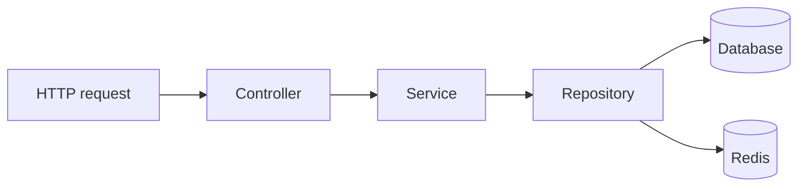

# Modular Backend

[](https://skills.sh/yigitcicekci/modular-backend/modular-backend)

Modular Backend is an Agent Skill for building and revising NestJS and Node.js backends with Fastify for HTTP. It gives coding agents a way to decide where code belongs, how data should be stored and accessed, and what to verify before delivering a change. It is designed for both a new API and a focused change in an existing service.

## Install and use

Run the command from your project and select your coding agent.

```sh
npx skills add yigitcicekci/modular-backend --skill modular-backend
```

Use the skill by name in your request. Clients that support explicit skill invocation may let you select it from a menu or invoke it directly.

Claude, Codex, Cursor, and Gemini-based coding agents can read the same Markdown instructions. Discovery and invocation depend on the client. For manual setup, keep the directory intact and add an instruction that points your agent at `SKILL.md`.

```text
For NestJS/Node.js backend work, read ./modular-backend/SKILL.md and follow
the references relevant to the task. Preserve the current project's contracts
and keep changes within the requested scope.
```

The core instructions are portable Markdown with local references. The optional `agents/openai.yaml` provides display metadata for clients that support it. [Agent Skills format](https://agentskills.io/specification)

## How the skill works

The agent starts with [SKILL.md](SKILL.md) and opens the references relevant to the task. Before editing it inspects the package manifest, project conventions, affected modules and callers, and relevant schemas, Redis usage, and tests. It uses the project's existing tools and follows the requested scope.

| Starting point | How the agent proceeds |
| --- | --- |
| **New backend** | Uses Fastify for HTTP through Nest's Fastify adapter or directly in a Node.js application without Nest. Builds the required domain modules, wires bootstrap and validated configuration, assigns Redis a useful role, and includes required persistence, migrations, local setup, and checks. |
| **Existing backend** | Traces callers and dependencies. Applies the conventions to the code involved in the request while preserving API responses, authorization and ownership filters, transaction behavior, and compatibility with existing data. Updates wiring, tests, and consumers as needed. |

The examples use tools such as Prisma, BullMQ, Docker, and GitHub Actions to show the approach in code. The agent adapts them to the installed ORM, queue, Redis client, and delivery platform. It adds optional features such as device registration, push notifications, or workers when the requested workload calls for them.

## Architecture and data flow

Every feature module includes DTOs, a controller, a service, a repository, and a Nest module definition. A single controller, service, or repository sits at the feature root. Group a layer in `controllers/`, `services/`, or `repositories/` once it has multiple files. Use `errors/` for domain-specific error definitions.

```text
src/modules/books/
  dto/
  errors/
  books.controller.ts
  books.service.ts
  books.repository.ts
  books.module.ts
```



| Component | Responsibility |
| --- | --- |
| **DTO and controller** | Validate request input, take identity from the authenticated context, and delegate the HTTP request to the service. |
| **Service** | Make business decisions, coordinate workflows, and translate domain outcomes into the appropriate result or error. |
| **Repository** | Execute database queries and Redis operations. Apply ownership filters and make state changes conditional or atomic where required. |
| **Module and errors** | Wire dependencies, export the providers other modules need, and define domain errors that fit the project's public response contract. |

For example, when an authenticated user archives a book, the controller supplies the book ID and the authenticated owner ID. The service asks the repository to archive an active book. The repository applies the book ID, owner ID, and current status in the same update. The service handles a zero-row result with the domain error. That keeps ownership and the state transition safe under concurrent requests.

Business actions in another domain go through that domain's service. An exported repository can be called directly for data-only work or a shared transaction. If a workflow spans repositories, the service can start the transaction and pass the same client to each participant. A repository can manage a self-contained atomic operation. Domain helpers stay local until another module actually needs them.

## Bootstrap and packages

Start with one `bootstrap()` in `main.ts` and pass `new FastifyAdapter()` explicitly when creating the Nest application. If tests or another entry point need the same HTTP setup, share it through `configureHttp(app, config)`. Nest providers own external-service initialization and cleanup. For an existing service on another adapter, plan the Fastify migration as part of work on the HTTP stack.

Use Node.js built-ins, required Nest framework packages, and official Nest modules for features that need them. For example, use `fetch` for straightforward HTTP calls, `node:crypto` for UUIDs, and Nest pipes for request validation. Reuse the project's existing database and Redis integrations. If a feature requires a new external client or peer package, the agent explains the requirement and gets approval before adding it.

## Query performance and Redis

The agent looks at queries, round trips, rows, and fields before adding infrastructure. It batches related lookups, selects the fields the response uses, and keeps pagination bounded with stable ordering. Running one query per row in parallel still creates N+1 traffic. New indexes need an access pattern or integrity constraint, and existing primary, unique, and composite indexes count toward that decision.

Redis is part of new backend infrastructure under this skill. Each use gets an explicit role and policy for ownership, updates, expiry, missing keys, outages, and recovery.

| Redis role | Example | Read policy |
| --- | --- | --- |
| **Primary data** | Active sessions with Redis as the authoritative store | A missing session means it is absent. Redis outages follow the documented failure policy. SQL does not substitute for the session store. |
| **Prepared read model** | A ranking or catalog projection filled ahead of requests | Reads use the projection. A missing key is handled as absence or a readiness issue, and a refresh or rebuild process restores it. |
| **Disposable cache** | A cached catalog response owned by SQL | A missing key can load from the owning repository under a cache-aside policy. A Redis failure is handled separately, with any fallback chosen explicitly. |

The agent keeps key and TTL definitions together, chooses Redis data structures around actual access patterns, and accounts for persistence or rebuilds when the data matters. An unrelated patch keeps the project's existing storage and fallback behavior.

## Identity, operations, and delivery

| Area | What the skill guides |
| --- | --- |
| **User, auth, and device** | Separate profile updates, credential verification, session management, and device metadata. Apply ownership checks and use response DTOs that expose only allowed fields. When refresh tokens are used, make rotation atomic and define replay and logout behavior. |
| **Configuration and operations** | Validate environment settings at startup. Use shared rate limits where needed, consistent errors and request IDs, and logs that protect credentials. Check required dependencies in readiness probes. |
| **Background work** | Separate API and worker roles when they need to scale independently. Keep batches and retries bounded, treat job delivery as potentially repeated, and make webhook or job side effects safe to retry. |
| **CI/CD** | Gate releases on checks, promote an immutable artifact, run required migrations once per environment release, and verify readiness and smoke tests. Track the previous artifact and its schema compatibility for rollback. |

The task determines the verification. A query change calls for evidence about query count or result shape. An auth change may need checks for ownership, expiry, replay, or immediate revocation. A storage change should distinguish a missing key from an outage. The agent reports which checks it ran and what still needs a real database, Redis instance, or deployment environment.

## Example requests

| Ask the agent | Expected result |
| --- | --- |
| **Build a NestJS API with email login and mobile device registration.** | Working user, auth, and device flows with validated config, defined session and Redis policies, persistence, and behavior checks. |
| **Move the profile query into a repository. Preserve the response and permissions.** | The query moves behind the module boundary, retaining tenant and ownership filters, error behavior, and any active transaction client. |
| **Remove N+1 reads from the library endpoint and check the query count.** | Related records are fetched in batches and mapped to the existing response. Query count is checked on suitably sized inputs. |
| **Add CI gates and a safe release path to this backend.** | The existing platform runs the required checks, builds the release artifact, and defines the migration, rollout, verification, and rollback steps. |

## References

| Read | For |
| --- | --- |
| [Architecture](references/architecture.md) | Module layout, DTOs, dependency injection, typed errors, and safe refactoring. |
| [Data and Redis](references/data-and-redis.md) | Batching, pagination, index selection, transaction ownership, and Redis failure policies. |
| [Identity](references/identity.md) | Registration, login, refresh rotation, recovery, OAuth, device registration, and permissions. |
| [Operations](references/operations.md) | Bootstrap, validation, config, rate limits, logs, health, and verification. |
| [Background work](references/background-work.md) | Workers, scheduling, idempotency, retries, and resource limits. |
| [CI/CD](references/ci-cd.md) | Pull request checks, containers, migration order, release credentials, and rollback. |

## License

[MIT](LICENSE). Linked external documentation retains its own licensing. Examples are original, generic illustrations rather than private project source.
