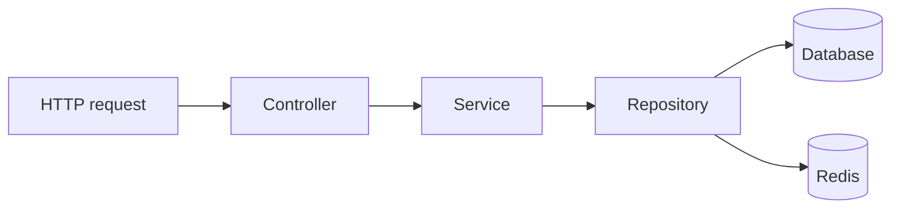

# Modular Backend

[](https://skills.sh/yigitcicekci/modular-backend/modular-backend)

Modular Backend is an Agent Skill for building and revising NestJS and Node.js backends with Fastify for HTTP. It gives coding agents a way to decide where code belongs, how data should be stored and accessed, and what to verify before delivering a change. It is designed for both a new API and a focused change in an existing service.

## Install and use

Run the command from your project and select your coding agent.

```sh
npx skills add yigitcicekci/modular-backend --skill modular-backend
```

Use the skill by name in your request. Clients that support explicit skill invocation may let you select it from a menu or invoke it directly.

Claude, Codex, Cursor, and Gemini-based coding agents can read the same Markdown instructions. Discovery and invocation depend on the client. For manual setup, keep the directory intact and add an instruction that points your agent at `SKILL.md`.

```text
For NestJS/Node.js backend work, read ./modular-backend/SKILL.md and follow
the references relevant to the task. Preserve the current project's contracts
and keep changes within the requested scope.
```

The core instructions are portable Markdown with local references. The optional `agents/openai.yaml` provides display metadata for clients that support it. [Agent Skills format](https://agentskills.io/specification)

## How the skill works

The agent starts with [SKILL.md](SKILL.md) and opens the references relevant to the task. Before editing it inspects the package manifest, project conventions, affected modules and callers, and relevant schemas, Redis usage, and tests. It uses the project's existing tools and follows the requested scope.

| Starting point | How the agent proceeds |
| --- | --- |
| **New backend or foundation overhaul** | Uses Fastify through AppBuilder with Helmet, localized HTTP errors, and active Redis-backed rate limiting. Wires validated Redis config, delivers a Redis-owned feature, and uses bounded keyset pagination for growing lists. |
| **Backend-wide revision** | “Revise this backend according to modular-backend” covers the foundation, modules, database, Redis, and delivery checks. The agent fixes applicable gaps, runs the acceptance checks, and reports unresolved compatibility or migration decisions. |
| **Focused revision** | “Revise the auth module according to modular-backend” covers that module and its affected callers. The agent preserves API responses, authorization and ownership filters, transaction behavior, and compatibility with existing data. |

The examples use tools such as Prisma, BullMQ, Docker, and GitHub Actions to show the approach in code. The agent adapts them to the installed ORM, queue, Redis client, and delivery platform. It adds optional features such as device registration, push notifications, or workers when the requested workload calls for them.

## Architecture and data flow

Every feature module includes DTOs, a controller, a service, a repository, and a Nest module definition. A single controller, service, or repository sits at the feature root. Group a layer in `controllers/`, `services/`, or `repositories/` once it has multiple files. Use `errors/` for domain-specific error definitions.

```text
src/modules/books/
  dto/
  errors/
  books.controller.ts
  books.service.ts
  books.repository.ts
  books.module.ts
```



| Component | Responsibility |
| --- | --- |
| **DTO and controller** | Validate request input, take identity from the authenticated context, and delegate the HTTP request to the service. |
| **Service** | Make business decisions, coordinate workflows, and translate domain outcomes into the appropriate result or error. |
| **Repository** | Execute database queries and Redis operations. Apply ownership filters and make state changes conditional or atomic where required. |
| **Module and errors** | Wire dependencies, export the providers other modules need, and define domain errors that fit the project's public response contract. |

For example, when an authenticated user archives a book, the controller supplies the book ID and the authenticated owner ID. The service asks the repository to archive an active book. The repository applies the book ID, owner ID, and current status in the same update. The service handles a zero-row result with the domain error. That keeps ownership and the state transition safe under concurrent requests.

Business actions in another domain go through that domain's service. An exported repository can be called directly for data-only work or a shared transaction. If a workflow spans repositories, the service can start the transaction and pass the same client to each participant. A repository can manage a self-contained atomic operation. Domain helpers stay local until another module actually needs them.

## Error responses and i18n

Each feature defines its own errors with a stable `code`, an HTTP `status`, and a translation `messageKey`. A typed registry collects the definitions. Services throw `AppException`; a single global HTTP filter translates the message using the request locale and sends the response. Clients branch on `code`, which remains identical in every locale.

```json
{"status":404,"code":"BOOK_NOT_ACTIVE_OR_NOT_FOUND","message":"Etkin kitap bulunamadı."}
```

The same filter handles framework and validation errors, preserves headers such as `Retry-After`, and returns a generic localized message for unexpected failures. Existing APIs keep their published response fields until a compatible migration. The reference includes the filter, locale configuration, catalog packaging, and integration checks. [Errors and i18n](references/errors-and-i18n.md)

## Bootstrap and packages

The HTTP app is created in `src/builder/app.builder.ts` and started by `src/main.ts`. The builder sets up Fastify, registers `@fastify/helmet` before initialization, and applies the validated HTTP configuration. Integration tests use the same builder and verify headers on a live route through Fastify injection. Nest providers own external service initialization and cleanup.

Use Node.js built-ins and official Nest modules wherever they meet the need. Fastify, its compatible Helmet plugin, and one Redis client are the baseline package choices. Reuse the project's existing Redis client, or use node-redis for a new project. For localized Nest HTTP errors, reuse the installed i18n integration or use `nestjs-i18n`. Password flows can use `argon2` for Argon2id. Other third-party packages require an explicit decision.

The local Docker workflow runs PostgreSQL when needed and Redis through Compose. `start-local.sh` waits for healthy dependencies, applies committed local migrations and starts the API watcher in the foreground. `stop-local.sh` shuts down the Compose project and retains its data volumes. The production image runs compiled Node code as a non-root user. When jobs need an independent worker, the same image can start its worker entrypoint with role-specific config. [Docker examples](references/docker.md)

## Query performance and Redis

The agent looks at queries, round trips, rows, and fields before adding infrastructure. It batches related lookups, selects the fields the response uses, and keeps pagination bounded with stable ordering. Running one query per row in parallel still creates N+1 traffic. New indexes need an access pattern or integrity constraint, and existing primary, unique, and composite indexes count toward that decision.

Growing lists validate the limit and cursor, fetch one extra row, and return `{ items, nextCursor }`. A chronological cursor carries the timestamp and unique row ID. The query keeps the owner or tenant scope and current filters on every page. Page numbers and exact totals are available when the API contract needs them.

The baseline includes `redis.config.ts`, `redis-keys.config.ts`, and `redis-ttl.config.ts`, a shared Redis provider, and readiness checks. At least one real feature reads and writes its data through a Redis repository. For example, an authorized publisher stores the minimum supported client build in Redis and the client-config route reads it from there. The owning feature defines updates, expiry, missing-key behavior, outages, and recovery.

| Redis role | Example | Read policy |
| --- | --- | --- |
| **Primary data** | Active sessions with Redis as the authoritative store | A missing session means it is absent. Redis outages follow the documented failure policy. SQL does not substitute for the session store. |
| **Prepared read model** | A ranking or catalog projection filled ahead of requests | Reads use the projection. A missing key is handled as absence or a readiness issue, and a refresh or rebuild process restores it. |
| **Disposable cache** | A cached catalog response owned by SQL | Loading from SQL on a miss requires an explicitly agreed cache-aside policy. It does not count as a Redis-owned feature. |

Redis-owned records and prepared projections are served from Redis. A missing required configuration and a Redis outage produce distinct failures. Neither triggers a request-time SQL query. Foundation tests cover the real write/read path, missing data and outage behavior.

## Identity, operations, and delivery

| Area | What the skill guides |
| --- | --- |
| **User, auth, and device** | Separate profile and account rules, credential verification, device metadata, and sessions. Use `@nestjs/jwt` for Nest JWT flows and Argon2id for new password flows. Bind mobile sessions to a validated installation and apply atomic refresh rotation. |
| **Fingerprints** | Use Argon2id for passwords, SHA-256 digests for high-entropy bearer tokens, and purpose-specific HMAC for trusted client IP and normalized account keys. |
| **Request guards and decorators** | Validate mobile headers once and expose typed device context. Register JWT and role guards on the routes they protect. Parameter decorators expose the verified user and device. Keep request summaries redacted. |
| **Configuration and operations** | Validate environment settings at startup. Register a Redis-backed limiter with a default budget, tighter policies for sensitive routes, and separate counters for login IP and account. Return 429 with `Retry-After` and 503 if required enforcement fails. Use safe logs and probe required dependencies. |
| **Background work** | Register schedules only for workloads that need them. Use a typed scheduler flag, stable job IDs, ordered domain steps for real pipelines, bounded batches and retry-safe side effects. Separate API and worker roles when needed. |
| **CI/CD** | Gate releases on checks, promote an immutable artifact, run required migrations once per environment release, and verify readiness and smoke tests. Track the previous artifact and its schema compatibility for rollback. |

The task determines the verification. A query change calls for evidence about query count or result shape. An auth change may need checks for ownership, expiry, replay, or immediate revocation. A storage change should distinguish a missing key from an outage. The agent reports which checks it ran and what still needs a real database, Redis instance, or deployment environment.

## Example requests

| Ask the agent | Expected result |
| --- | --- |
| **Build a NestJS API with email login and mobile device registration.** | Working user, auth, and device flows with validated config, defined session and Redis policies, persistence, and behavior checks. |
| **Move the profile query into a repository. Preserve the response and permissions.** | The query moves behind the module boundary, retaining tenant and ownership filters, error behavior, and any active transaction client. |
| **Remove N+1 reads from the library endpoint and check the query count.** | Related records are fetched in batches and mapped to the existing response. Query count is checked on suitably sized inputs. |
| **Add CI gates and a safe release path to this backend.** | The existing platform runs the required checks, builds the release artifact, and defines the migration, rollout, verification, and rollback steps. |

## References

| Read | For |
| --- | --- |
| [Architecture](references/architecture.md) | Module layout, DTOs, dependency injection, and safe refactoring. |
| [Errors and i18n](references/errors-and-i18n.md) | Typed error registry, global filter, localized response contract, and release catalogs. |
| [Data and Redis](references/data-and-redis.md) | Batching, pagination, index selection, transaction ownership, and Redis failure policies. |
| [Identity](references/identity.md) | Registration, login, refresh rotation, recovery, OAuth, device registration, and permissions. |
| [Request boundary](references/request-boundary.md) | Header, JWT and role guards, decorators, and Fastify request hooks. |
| [Operations](references/operations.md) | Bootstrap, validation, config, rate limits, logs, health, and verification. |
| [Background work](references/background-work.md) | Workers, scheduling, idempotency, retries, and resource limits. |
| [Docker](references/docker.md) | Compose, Bash start/stop scripts, and API/worker image commands. |
| [CI/CD](references/ci-cd.md) | Pull request checks, containers, migration order, release credentials, and rollback. |

## License

[MIT](LICENSE). Linked external documentation retains its own licensing. Examples are original, generic illustrations rather than private project source.
